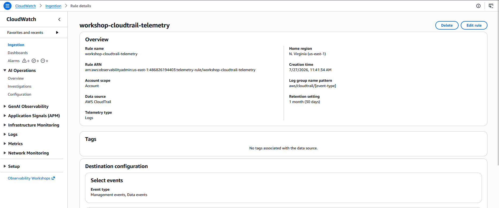
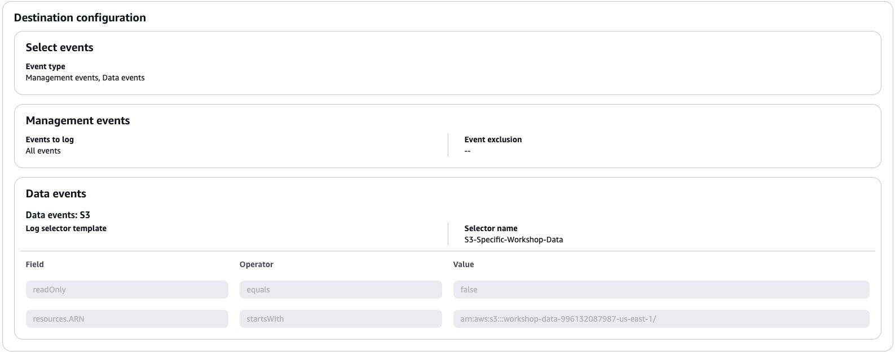
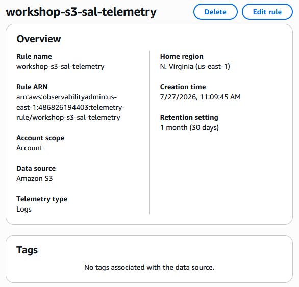
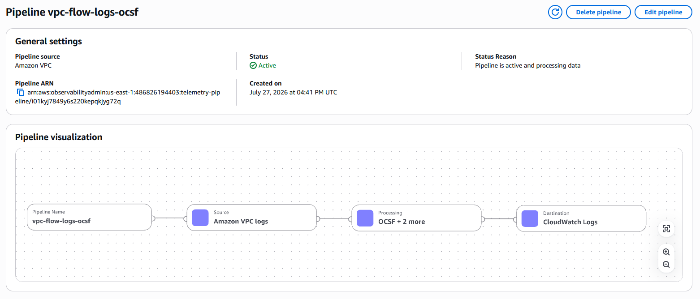
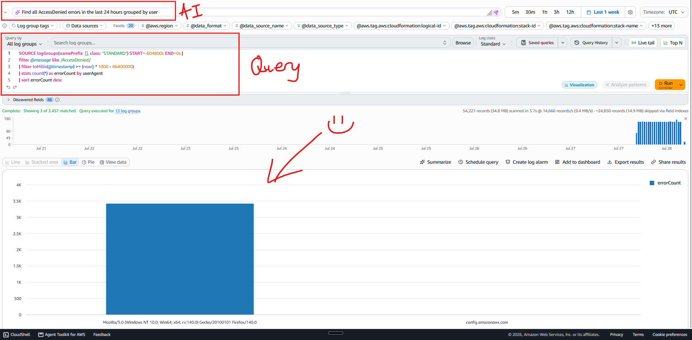
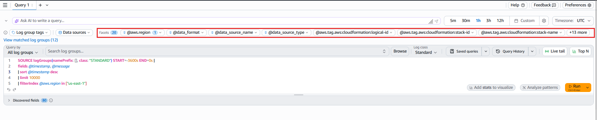

## Overview
In this project, the goal is to learn how to centralize, query, and act on security telemetry using CloudWatch's Unified Data Store. I'll be walking through some hands-on labs that cover CloudTrail ingestion, interactive security analytics with Logs Insights, anomaly detection, and cross-source investigation scenarios.

This project was built as part of AWS's Security Visibility and Analytics Activation Day. Security Visibility and Analytics Activation Day provides hands-on experience with AWS CloudTrail Events in the Amazon CloudWatch unified data store. Learn to capture account activity and resource operations for auditing, compliance, and troubleshooting.

**Topics**: Analytics, Cloud Operations, Security, Identity, and Compliance

**AWS Services**: Amazon CloudWatch Logs, Amazon CloudWatch, AWS CloudTrail

## Foundations of UDS
**Amazon CloudWatch unified data store (UDS)** ingests security log sources from AWS Cloudtrail, S3, VPC Flow Logs, AWS WAF,a nd DNS in Route 53.

### Reviewing telemetry collection
Telemetry **enablement rules** is how the UDS collects logs from a source without manual trail setup, destination buckets, or custom IAM. Each rule names a data source and a destination (CloudWatch Logs).

For AWS CloudTrail specifically, the rule can also carry **advanced event selectors** that scope which data events are captured. 

#### Cloudtrail telemetry rules
Cloudtrail captures the _identity_ view of activity: who called which API, from where, with what result. 



From the screenshot, we can see that the **Data source** is AWS CloudTrail, the **Destination** is CloudWatch Logs, managed log group pattern `aws/cloudtrail/[event-type]`, and the event types are both Management events and Data events.
- **Management events**: all account-wide API activity. Think of them as the control plane. Management events detail who opened the metaphorical door.
- **Data events**: object-level operations, like S3 or Lambda. These events deal with the access or modification of data. You can think of them as the logs of who accessed the metaphorical safe.
  - Importantly, Data events are turned off by default. This is because they can be extremely noisy - imagine how many times you might access buckets, invoke Lambda functions, or any other operations. You can see how this might be overwhelming.

#### Why advanced event selectors matter
Data event are high-volume, so the rule uses **advanced event selectors** to capture only what's relevant: a key cost-control and signal-to-noise technique that can be applied to any high-volume source. The rule we have has two selectors:
1. Management events - captures all management events (`eventCategory = Management`).
2. Scoped S3 data events (`S3-Specific-Workshop-Data`) - captures only **write** operations on the workshop data bucket:
   - **Field**: readOnly **Equals** `false`
   - **Field**: resources.ARN **startsWith** `arn:aws:s3:::workshop-data-${AccountID-${Region}` 



#### The technique to take home
The `readOnly = false + resources.ARN startsWith` combination is the pattern to remember: log only write operations on a specific bucket, cutting data-event volume while guaranteeing delivery for the mutations that matter most. This is how you'd scope CloudTrail data events in production.

#### Reviewing S3 server access log telemetry rule
S3 servr access logs are the complementary source. They add the _HTTP-level_ view of every bucket request (TLS version, bytes transferred, signature version) that Cloudtrail **does not record**. 



We can see from the image that the enablement rule takes the same shape as the CloudTrail rule.

### Understanding CloudWatch telemetry pipelines
A **CloudWatch telemetry pipeline** transforms raw logs as they're ingested. It reads from a source, runs the records through one or more processers, and writes the result to a destination. 

One of the most common processors is the OCSF processor, which normalizes logs into the **Open Cybersecurity Schema Framework**.

#### Why normalize?
Why normalize to OCSF? Native AWS log formats are service-specific. OCSF gives you consistent field names and structures across security tools and platforms, which helps multi-vendor SOCs and SIEMs and lets you correlate multiple AWS log sources in one query. 



Here's the pipeline's definition as code:

```yaml
pipeline:
  source: # reads the source identified by a data_source_name / data_source_type pair
    cloudwatch_logs:
      aws:
        sts_role_arn: arn:aws:iam::486826194403:role/security-visibility-worksho-VpcFlowOcsfPipelineRole-uDQp4iuRBf1X
      log_event_metadata:
        data_source_name: amazon_vpc
        data_source_type: flow
  processor:
    - ocsf:
        schema:
          vpc_flow: null
        version: "1.5"
        mapping_version: 1.5.0
    - copy_values:
        when: connection_info.protocol_num != null
        entries:
          - from_key: connection_info.protocol_num
            to_key: protocol_name
            overwrite_if_to_key_exists: false
    - substitute_string:
        when: protocol_name != null
        entries:
          - source: protocol_name
            from: ^6$
            to: TCP
          - source: protocol_name
            from: ^17$
            to: UDP
          - source: protocol_name
            from: ^1$
            to: ICMP
  sink: # log_group: "@original" sends the transformed records back to the originating log group. For a cloudwatch_logs source this is the only allowed value: the pipeline transforms the records in place as they're ingested.
    - cloudwatch_logs:
        log_group: "@original" 
```

One important concept to understand is that the processors have an order to them. There's a reason why `oscf:` comes first, then `copy_values`, then `substitute_string`.

| # | Processor | What it does | Why it matters |
| --- | --- | --- |
| 1 | `oscf`  | Normalizes each VPC flow record into the OCSF vpc_flow schema (v1.5). Raw fields become standardized OCSF paths (e.g. byte counts → traffic.bytes, the protocol number → connection_info.protocol_num). | One consistent schema you can correlate against other OCSF sources. |
| 2 | `copy_values` | Copies connection_info.protocol_num into a new protocol_name field — but only when the protocol number is present. | Adds a derived field without losing the original. Conditional (when) means it only fires on records that have the source field. |
| 3 | `substitute_string` | Rewrites the protocol_name value: 6 → TCP, 17 → UDP, 1 → ICMP. | Enrichment so, for example, you don't have to remember that IANA protocol 6 means TCP. | 

## Investigate
### AI-powered query generation and summarization
CloudWatch Logs Insights supports a natural language query capability to help you generate and update queries for CloudWatch Logs Insights QL, OpenSearch SQL, and OpenSearch PPL. You can use plain English prompts to automatically generate queries without learning complex syntax. Below, I've asked the AI to "Find all AccessDenied errors in the last 24 hours grouped by user". 



Once you've run your query, you can again ask the AI to summarize the data. Here's the AI summary:

> The logs show 3,457 total AccessDenied errors across three user agent categories. The dominant source is requests with no user agent, accounting for 3,420 errors, which represents approximately 98.9% of all AccessDenied occurrences. Firefox 140.0 on Windows 10 (64-bit) is the second-largest source with 33 errors. The AWS Config service endpoint (config.amazonaws.com) contributed 4 errors. The concentration of errors in the no-user-agent category is notably disproportionate compared to the browser and AWS service sources.

These features are powered by Amazon Bedrock.

### Querying with QL, SQL, and PPL
CloudWatch Logs Insights supports three query languages so you can use whichever fits the task: Logs Insights QL (the native language, optimized for CloudWatch), OpenSearch PPL (piped commands, Unix-pipe style), and OpenSearch SQL (familiar relational syntax). 

### Interactive log exploration with facets
CloudWatch Logs Insights facets enable interactive log analysis by allowing you to filter query results through point-and-click selection. 



To learn more about facets, correlation, enrichment, automation in CloudWatch Log Analytics, go to [this Amazon blog post](https://aws.amazon.com/blogs/mt/log-analysis-with-facets-correlation-enrichment-and-automation-in-amazon-cloudwatch-log-analytics/).

The key takeaway is this: **Facets** are for exploring log data visually without writing a query.

### Enriching and correlating across sources
CloudWatch Log Analytics provides four building blocks for enrichment and correlation: **lookup tables, parameterized queries, JOIN, and sub-queries**.

1. **Lookup tables** for enriching query results with external metadata.
2. **Parameterized** **queries** for saving reusable templates with fill-in variables. 
3. **JOIN** and **sub-queries** for correlating data across log groups in a single query. The primary query runs against one log group. The JOIN pulls matching events from a second log group based on a shared field, such as an IP address, user ID, or request ID.
4. **Scheduled** **queries** for running queries automatically and delivering results to Amazon Simple Storage Service (Amazon S3) or Amazon EventBridge.

Again, if you would like more information, please visit the above Amazon blog post as they also provide a lab you can do as well.

## Detect and alert
### Metric filters
A metric filter turns a log pattern into a CloudWatch metric, and a CloudWatch alarm notifies you when that metric crosses a threshold.

To go more into detail:
1. A **metric filter** scans a log group for a pattern and increments a CloudWatch metric on each match, converting raw logs into a quantifiable, alarmable signal. Because the unified data store delivers logs as structured JSON, filters use JSON match syntax ($.field) regardless of source.
2. **CloudWatch alarms** turn the metrics from your metric filters into action, notifying your team the moment a security pattern crosses a threshold. The mechanism is identical across sources: pick a metric, set a threshold and evaluation period, and attach an SNS notification. Even a single occurrence can trigger an alarm when that's the right policy.

## Rank and visualize
**Contributor Insights** continuously ranks the top contributors to a pattern (top requesters generating errors, top downloaders by volume), and those rankings, together with your metrics and alarms, come together on a CloudWatch dashboard, the single pane your team watches.

You can build Contributor Insights rules for CloudTrail and S3 server access logs from scratch, or deploy a pre-built Security, Compliance & Audit dashboard from CloudFormation.

### Contributor Insights
CloudWatch Contributor Insights continuously analyzes a log group and ranks the top-N contributors to a pattern (the principals, IPs, or buckets driving the most activity) without you running queries by hand. The rule body uses JSON match syntax and names a contribution key (what to rank by), filters, and an aggregation.

## Advanced analytics
So far, everything we have been doing has been within CloudWatch. However, we can extend the UDS outwards. For example, we can query normalized security data with Apache Iceberg-compatible tools (Amazon Athena via S3 Tables) for large-scale, SQL-based analysis and long-term retention, and apply AI-assisted threat detection to surface patterns across sources.